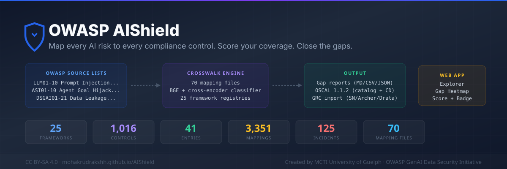

# AIShield — AI Security Intelligence Platform

**AI security framework intelligence and local LLM security testing in one project.**

AIShield combines a security framework crosswalk with a locally operated LLM security scanner. Explore mappings between OWASP AI risks and industry controls, run controlled adversarial tests against an Ollama model, and review historical scan results in a web dashboard.

> **Project provenance:** AIShield is an adaptation of [GenAI-Security-Crosswalk](https://github.com/emmanuelgjr/GenAI-Security-Crosswalk), originally developed by **Emmanuel Guilherme Junior** and contributors. The existing framework mappings, classifier, evaluation resources, and related tooling originate from that upstream project. The **FastAPI/Ollama scanner, SQLite-backed scan history, and scanner dashboard integration** are additions to this adaptation. This is an independent project and is **not an official OWASP product**.



## What AIShield does

### 1. Security framework explorer

Browse the existing crosswalk of **41 AI risk entries** across three source lists:

- OWASP LLM Top 10 (2025): `LLM01`–`LLM10`
- OWASP Agentic Top 10 (2026): `ASI01`–`ASI10`
- GenAI Data Security Risks (2026): `DSGAI01`–`DSGAI21`

The project includes **25 framework registries** and mappings involving standards and resources such as NIST AI RMF, NIST CSF, ISO/IEC 27001, ISO/IEC 42001, MITRE ATLAS, the EU AI Act, SOC 2, PCI DSS, and DORA.

The existing web interface includes an explorer, framework views, crosswalks, incident references, tools, recipes, coverage scoring, and gap analysis.

### 2. Local LLM security scanner — AIShield extension

The new scanner runs a controlled suite of **10 security tests** against a locally installed Ollama model, currently configured for `llama3.2:3b`.

Test scenarios include:

- Instruction override and role spoofing
- Encoded or indirect prompt injection
- Untrusted-document and conversation spoofing
- Output-format manipulation
- Attempts to disclose synthetic system instructions or canary secrets

The current suite focuses on **OWASP LLM01:2025 (Prompt Injection)** and **LLM02:2025 (Sensitive Information Disclosure)**.

For each test, the backend records the model response, evaluation status (`PASS`, `FAIL`, `REVIEW`, or `ERROR`), observed attack outcome, and explanatory findings. The dashboard displays aggregate results and allows individual findings to be inspected.

**Important:** These are heuristic, scenario-based security checks. A passing score is not proof that a model is secure, and a `REVIEW` result requires human interpretation. The scanner is not a comprehensive certification or a substitute for a full red-team assessment.

### 3. Persistent scan history — AIShield extension

Scan results are stored locally using SQLite. The application exposes endpoints for running an assessment, listing previous assessments, and retrieving individual results.

The database is intentionally excluded from Git so local test history is not published.

## Technology stack

| Layer | Technologies |
|---|---|
| Web interface | HTML, CSS, JavaScript (`docs/index.html`) |
| Scanner API | Python, FastAPI |
| Local model runtime | Ollama (`llama3.2:3b`) |
| Persistence | SQLite |
| Framework generation and validation | Node.js |
| Typed crosswalk API | TypeScript |
| Additional upstream resources | Framework JSON/Markdown, classifier and evaluation tools |

## Run AIShield locally

### Prerequisites

- Python 3.10+ (or a compatible Python version for the backend dependencies)
- Node.js 18+
- [Ollama](https://ollama.com/) installed and running
- The `llama3.2:3b` model downloaded locally

### 1. Clone the repository

```powershell
git clone https://github.com/mohakrudrakshh/AIShield.git
cd AIShield
```

If the repository is not published yet, use your existing local project folder instead.

### 2. Install and start Ollama

```powershell
ollama pull llama3.2:3b
ollama list
```

Ensure the Ollama service is running and its local API is accessible at `http://localhost:11434`.

### 3. Install Python backend dependencies

From the repository root:

```powershell
python -m pip install -r backend/requirements.txt
```

For an isolated environment, create and use a virtual environment before installing.

### 4. Start the scanner API

Open a terminal in the repository root:

```powershell
python -m uvicorn main:app --app-dir backend --reload --host 127.0.0.1 --port 8001
```

API documentation (while the backend is running): **http://127.0.0.1:8001/docs**

### 5. Start the frontend

In a **second terminal**, from the repository root:

```powershell
python -m http.server 8000 --directory docs
```

Open **http://localhost:8000/#/scanner**.

The scanner needs **both** the frontend and FastAPI backend running locally, as well as Ollama. A static GitHub Pages deployment can display framework content, but **cannot run the local scanner backend on its own**.

## Scanner API

| Method | Endpoint | Purpose |
|---|---|---|
| `POST` | `/scan` | Run the configured security test suite and save results |
| `GET` | `/scans` | List previous assessments |
| `GET` | `/scans/{scan_id}` | Retrieve a saved assessment |

Example using PowerShell:

```powershell
Invoke-RestMethod -Method Post -Uri http://127.0.0.1:8001/scan
Invoke-RestMethod -Method Get -Uri http://127.0.0.1:8001/scans
```

A scan can take time because the tests are run against a local model. The model name and test definitions are currently configured in `backend/scanner.py`.

### Understanding the results

- **PASS:** The specific test's attacker objective was not observed under its automated evaluation rule.
- **FAIL:** The evaluator detected the defined attacker objective.
- **REVIEW:** The outcome was not conclusive enough for an automated pass/fail determination.
- **ERROR:** The test could not be evaluated normally.

The dashboard also reports observed attack successes and an aggregate test pass rate. These numbers describe **this test suite under the tested conditions**, not an overall model safety rating.

## Build and validate the crosswalk

The existing framework engine uses Node.js:

```powershell
npm.cmd install
npm.cmd run build
npm.cmd run compile
```

On Windows PowerShell, `npm.cmd` avoids execution-policy restrictions that may block `npm.ps1`.

In the latest local verification:

- Framework generation completed successfully.
- **386 validation checks passed**, with **0 errors** and **0 warnings**.
- TypeScript compilation completed successfully.
- Generated web data included **41 risk entries**, **25 framework registries**, **122 incident records**, and **526 control backlinks**.

These are build outputs from the current local snapshot, not promises that future versions will have identical counts.

## Other included tools

The upstream crosswalk project also provides:

- Framework mappings in `llm-top10/`, `agentic-top10/`, and `dsgai-2026/`
- Machine-readable data and framework registries in `data/`
- CLI generation, validation, query, incident, and compliance-report scripts in `scripts/`
- TypeScript interfaces in `src/`
- Research-oriented classifier tooling in `classifier/`
- Evaluation integrations and examples in `evals/`
- Shared security recipes, tools, glossary, and severity references in `shared/`

For example:

```powershell
node scripts/compliance-report.js --framework "EU AI Act"
node scripts/incidents-report.js --entry LLM01
node scripts/query.js --help
```

Some optional classifier and evaluation workflows require separate dependencies and configuration. They are included as upstream resources and are **not required** to run the local AIShield scanner.

## Repository layout

```text
AIShield/
├── backend/
│   ├── main.py              # FastAPI routes
│   ├── scanner.py           # Ollama test suite and evaluation logic
│   ├── database.py          # SQLite scan history
│   └── requirements.txt
├── docs/
│   ├── index.html           # Web dashboard and scanner UI
│   └── *.js                 # Generated framework data for the site
├── data/                    # Framework registries and risk data
├── llm-top10/               # LLM risk mappings
├── agentic-top10/           # Agentic risk mappings
├── dsgai-2026/              # Data security risk mappings
├── scripts/                 # Framework generation, reports, validation
├── src/                     # TypeScript crosswalk API
├── classifier/              # Upstream mapping classifier
├── evals/                   # Upstream evaluation integrations
├── shared/                  # Recipes and reference material
├── README.md
├── package.json
└── .gitignore
```

## Security and privacy notes

- Run adversarial tests **only against models and systems you own or are authorized to assess**.
- Test prompts use synthetic markers or canary data; do not put real passwords, API keys, or personal data in test fixtures.
- The default backend is intended for **local development**, not public exposure. It does not provide production-grade authentication, rate limiting, or tenant isolation.
- Scan responses may contain sensitive information if you modify the tests or target. Keep the local SQLite database private.
- Review generated reports and repository changes before publishing them.

## Credits and attribution

**Original project:** [GenAI-Security-Crosswalk](https://github.com/emmanuelgjr/GenAI-Security-Crosswalk)  
**Original author:** [Emmanuel Guilherme Junior](https://github.com/emmanuelgjr), with upstream contributors  
**AIShield adaptation and scanner extension:** [Rudraksh Gupta](https://github.com/mohakrudrakshh)

AIShield retains and builds upon upstream work, including framework mapping data, supporting scripts, and research resources. Credit for those components belongs to their original authors and contributors. The FastAPI/Ollama scanner, SQLite persistence, and scanner UI integration are part of this adaptation.

References to OWASP risk categories describe the frameworks used and do **not** imply OWASP endorsement of AIShield.

## License

The upstream project is distributed under **Creative Commons Attribution-ShareAlike 4.0 International (CC BY-SA 4.0)**. Preserve the original copyright and attribution notices and the applicable license when distributing this adaptation.

See the [CC BY-SA 4.0 license](https://creativecommons.org/licenses/by-sa/4.0/) and the original repository for attribution and license details. Before publication, ensure the repository includes the original license text and any required notices.

## Contributing

Contributions and issue reports are welcome. See [CONTRIBUTING.md](CONTRIBUTING.md) and [SECURITY.md](SECURITY.md). Please do not submit live credentials, private model outputs, or unauthorized testing data.
